# 🎬 Awesome Video AI Benchmarking & Evaluation 🚀

    

## 🌟 Top Video AI Benchmarking & Evaluation Ecosystem 🎯

**Curated List of Production SaaS Platforms & Open-Source GitHub Projects for Multimodal Video AI** 📽️✨

*Focused on Video LLM/MLLM Evaluation Harnesses, Generative Video Benchmarks (VBench, EvalCrafter), Perceptual Video Quality Metrics (VMAF, PSNR, SSIM, LPIPS), Long-Video QA, Video Understanding APIs & Cloud Video Analytics.* 🧠⚡

**Last updated: November 2026** 📅

---

## 📖 Table of Contents

- [📊 Sector Overview & Market Dynamics](#-sector-overview--market-dynamics)
- [☁️ SaaS & Hosted Platforms](#️-saas--hosted-platforms)
- [💻 Open-Source GitHub Projects](#-open-source-github-projects)
- [⭐ Star History](#-star-history)
- [🤝 Support & Sponsorship](#-support--sponsorship)
- [🛠️ How to Contribute](#️-how-to-contribute)
- [📜 Disclaimer](#-disclaimer)

---

## 📊 Sector Overview & Market Dynamics

The global Video AI and video analytics market is estimated at **$3.8 Billion to $5.5 Billion in 2024–2026**, projected to surge past **$35 Billion to $42 Billion by 2032** at an accelerating CAGR of **~29% to 32%** across synthetic video generation, temporal foundation models, and media intelligence. 📈🚀

Market structure is **highly concentrated at the foundation model tier** (dominated by hyperscalers and frontier research labs capable of financing billion-dollar GPU clusters), yet **moderately-to-highly fragmented across the benchmarking, perceptual evaluation, and developer tooling layer** where domain-specific metrics (VMAF, VBench, temporal coherence, hallucination rates) and specialized vertical harnesses prevent a single winner-take-all monopoly. 🌐🔍

---

## ☁️ SaaS & Hosted Platforms

Production-ready hosted APIs, video intelligence clouds, creator benchmarking suites, and independent AI model evaluation arenas. Sorted by estimated company size / valuation / market capitalization (descending). 🏆

| Platform / Product | Organization / Company | Company Size / Valuation / Revenue | Starting Paid Tier Pricing | Free Tier / Free Trial Limits | Core Features & Evaluation Capabilities |
| :--- | :--- | :--- | :--- | :--- | :--- |
| **[Azure AI Video Indexer](https://azure.microsoft.com/en-us/products/cognitive-services/video-indexer/)** | Microsoft Azure | $3.1 Trillion Market Cap | $0.045 / minute (Basic Video) to $0.15 / minute (Advanced Video) | Free Trial: 10 hours (600 mins) via web portal, or 40 hours (2,400 mins) via API portal | Cloud video analytics and multimodal indexing service extracting spoken transcripts, OCR text, faces, topics, sentiment, and scene segments from video archives. |
| **[Google Cloud Video Intelligence AI](https://cloud.google.com/video-intelligence)** | Alphabet / Google Cloud | $2.1 Trillion Market Cap | $0.10 / minute analyzed (beyond free tier) | 1,000 minutes/month free forever (stored + streaming) | Cloud machine-learning video analysis API providing shot-change detection, label annotation, speech transcription, and explicit content evaluation. |
| **[AWS Rekognition Video](https://aws.amazon.com/rekognition/)** | Amazon Web Services | $2.0 Trillion Market Cap | $0.10 / minute analyzed (stored video) | 60 minutes/month free for first 12 months (stored/streaming) + 1,000 face vectors/month | Managed deep-learning video analysis API detecting objects, scenes, activities, celebrities, text, and content moderation flags across stored and streaming video. |
| **[Cloudinary Video AI](https://cloudinary.com)** | Cloudinary Ltd. | $2.0 Billion Valuation (~$150M ARR) | $89 / month (Plus Plan, 225 credits) | 25 Credits/month free forever (25,000 transformations, 25 GB storage, or 25 GB bandwidth) | Cloud media management and delivery platform featuring AI quality optimization, automated perceptual quality scoring, smart cropping, and video tagging. |
| **[Mux Data & Video](https://mux.com)** | Mux, Inc. | $1.0 Billion Valuation (~$40M ARR) | $20 / month (Launch Plan credit minimum; pay-as-you-go thereafter) | 10 stored videos forever + 100,000 delivery minutes/month free (VOD) | Developer-first cloud video streaming and Quality of Experience (QoE) benchmarking platform tracking rebuffering, startup latency, and perceptual encoding metrics. |
| **[Twelve Labs](https://twelvelabs.io)** | Twelve Labs Inc. | $500 Million - $1.0 Billion Valuation (~$10M ARR) | $29 / month (Plus Plan) or $99 / month (Pro Plan) | 600 minutes (10 hours) total video indexing + 3 GB storage free forever | Cloud video understanding foundation model platform (Marengo & Pegasus) providing semantic video search, temporal event localization, chaptering, and video-to-text evaluation APIs. |
| **[vidIQ](https://vidiq.com)** | vidIQ | $50 Million - $80 Million Valuation (~$18M ARR) | $19 / month (Boost Plan, or $199 / year) | 150 AI credits/month forever + 3 competitor channels + 3 daily video ideas | AI-powered YouTube analytics, video performance benchmarking, title/thumbnail scoring, and audience retention optimization SaaS platform. |
| **[TubeBuddy](https://tubebuddy.com)** | BEN Group (TubeBuddy) | $20 Million - $40 Million Valuation (~$4.5M ARR) | $12 / month (Pro Plan, discounted to $3.60 - $4.50/mo annually) | 1 channel free forever (includes basic SEO studio, tag tools & search rank checks with limited search volume) | Cloud video creator optimization and A/B thumbnail/metadata benchmarking suite providing SEO scoring and competitive channel analytics. |
| **[Artificial Analysis Video Arena](https://artificialanalysis.ai)** | Artificial Analysis Inc. | $15 Million - $25 Million Valuation (Venture-Backed) | $417 / seat / month (Pro Plan) | Free public benchmark leaderboards & API free tier (with rate limits & attribution) | Independent cloud benchmarking leaderboard evaluating proprietary and open-source generative video models on blind human ELO preference, generation speed, and cost. |
| **[Gumlet](https://gumlet.com)** | Gumlet Inc. | $10 Million - $15 Million Valuation (~$1M ARR) | $6 / month (Creator Plan, or $19 / month Growth Plan) | 100 video storage minutes + 250 GB streaming bandwidth/month free forever | Cloud video hosting, adaptive bitrate streaming, and perceptual quality optimization platform measuring per-title encoding efficiency and playback QoE metrics. |
| **[Viesus](https://viesus.com)** | Viesus AG | Bootstrapped / Profitable (~$2M - $5M ARR) | $10 / month (Basic Plan, 400 credits) | 50 credits free forever (Try-out tier with full API access, AI upscaling & artifact removal) | Cloud and SDK automated image and video quality analysis/enhancement engine evaluating sharpness, exposure, color cast, and noise profiles across media pipelines. |

---

## 💻 Open-Source GitHub Projects

Every major active open-source project for video-LLM evaluation suites, generative video quality harnesses, Netflix VMAF/FFmpeg perceptual metrics, long-video QA benchmarks, and open video understanding models. Sorted by GitHub Star Count (descending). 🌟📈

- **[Open-Sora (hpcaitech/Open-Sora)](https://github.com/hpcaitech/Open-Sora)**   
  Democratizing efficient and accessible video generation for all; includes full evaluation scripts and quality harnesses across diverse text-to-video benchmarks.

- **[LLaVA (haotian-liu/LLaVA)](https://github.com/haotian-liu/LLaVA)**   
  Visual Instruction Tuning for Large Multimodal Models; foundational benchmark baseline for zero-shot visual reasoning and video frame question answering.

- **[Qwen2.5-VL (QwenLM/Qwen2.5-VL)](https://github.com/QwenLM/Qwen2.5-VL)**   
  Flagship open-weight Vision-Language model family supporting hour-long video comprehension, dynamic frame-rate sampling, and precise second-level event timestamp localization.

- **[CogVideo & CogVideoX (THUDM/CogVideo)](https://github.com/THUDM/CogVideo)**   
  Open-source text-to-video diffusion transformer family with comprehensive evaluation metrics for motion smoothness, temporal consistency, and prompt alignment.

- **[HunyuanVideo (Tencent/HunyuanVideo)](https://github.com/Tencent/HunyuanVideo)**   
  Open foundation model for high-definition video generation with dual-stream attention architecture and automated generative video quality evaluation suites.

- **[Open-Sora-Plan (PKU-YuanGroup/Open-Sora-Plan)](https://github.com/PKU-YuanGroup/Open-Sora-Plan)**   
  Large-scale open-source reproduction and benchmarking of video diffusion transformer models with rigorous perceptual fidelity and temporal consistency testing.

- **[InternVL (OpenGVLab/InternVL)](https://github.com/OpenGVLab/InternVL)**   
  Leading open-source multimodal foundation model suite achieving top leaderboard results on Video-MME, MVBench, and dense video captioning benchmarks.

- **[Netflix VMAF (Netflix/vmaf)](https://github.com/Netflix/vmaf)**   
  Industry-standard open-source perceptual video quality assessment algorithm and CLI/library predicting subjective human MOS scores by fusing multiple elementary quality metrics with SVM modeling.

- **[PySceneDetect (Breakthrough/PySceneDetect)](https://github.com/Breakthrough/PySceneDetect)**   
  Open-source video scene boundary detection and analysis Python tool/library for automated shot-transition extraction in video evaluation datasets.

- **[LMMs-Eval (EvolvingLMMs-Lab/lmms-eval)](https://github.com/EvolvingLMMs-Lab/lmms-eval)**   
  Distributed, reproducible open-source evaluation harness built for fast, standardized benchmarking of Large Multimodal Models across video QA, captioning, and temporal grounding datasets.

- **[VLMEvalKit (open-compass/VLMEvalKit)](https://github.com/open-compass/VLMEvalKit)**   
  Comprehensive open-source evaluation toolkit supporting one-command benchmarking of 200+ Video-LLMs and VLMs across Video-MME, MVBench, LongVideoBench, TempCompass, and EgoSchema.

- **[Video-LLaVA (PKU-YuanGroup/Video-LLaVA)](https://github.com/PKU-YuanGroup/Video-LLaVA)**   
  Foundational open-source multimodal LLM aligning image and video representations into a unified visual feature space for joint image-video instruction tuning and QA.

- **[PyIQA — Image & Video Quality Assessment Toolbox (chaofengc/IQA-PyTorch)](https://github.com/chaofengc/IQA-PyTorch)**   
  Extensive open-source PyTorch toolbox implementing 40+ full-reference and no-reference perceptual quality metrics (LPIPS, DISTS, NIQE, BRISQUE, MUSIQ, TOPIQ) for evaluating generated and upscaled video frames.

- **[MVBench & VideoChat (OpenGVLab/Ask-Anything)](https://github.com/OpenGVLab/Ask-Anything)**   
  Open-source temporal understanding benchmark featuring 20 dynamic video tasks (action sequence, object permanence, counterfactual inference) that cannot be solved from single static frames.

- **[Video-LLaMA (DAMO-NLP-SG/Video-LLaMA)](https://github.com/DAMO-NLP-SG/Video-LLaMA)**   
  Open-source multimodal framework empowering LLMs with video and audio-grounded understanding, temporal conversation, and comprehensive multimodal video QA evaluation.

- **[Show-o (showlab/Show-o)](https://github.com/showlab/Show-o)**   
  Unified open-source multimodal foundation model seamlessly handling multimodal comprehension and generation with benchmark evaluation across multimodal video benchmarks.

- **[TimeSformer (facebookresearch/TimeSformer)](https://github.com/facebookresearch/TimeSformer)**   
  Meta AI's seminal pure-transformer model for video action recognition with divided space-time attention, standard benchmark baseline across video classification datasets.

- **[VBench & VBench++ (Vchitect/VBench)](https://github.com/Vchitect/VBench)**   
  The industry-standard open-source benchmark suite for Video Generative Models evaluating 16+ disentangled dimensions including subject consistency, motion smoothness, dynamic degree, aesthetic quality, and temporal flickering.

- **[Video-ChatGPT (mbzuai-oryx/Video-ChatGPT)](https://github.com/mbzuai-oryx/Video-ChatGPT)**   
  Pioneering multimodal video conversation model with quantitative video evaluation protocol using LLM-assisted scoring for correctness, detail, and temporal consistency.

- **[VideoLLaMA 2 (DAMO-NLP-SG/VideoLLaMA2)](https://github.com/DAMO-NLP-SG/VideoLLaMA2)**   
  Advancing spatial-temporal modeling and audio understanding with Spatial-Temporal Convolutional connectors and standard video evaluation suites.

- **[VideoLLaMA 3 (DAMO-NLP-SG/VideoLLaMA3)](https://github.com/DAMO-NLP-SG/VideoLLaMA3)**   
  Open-source frontier video-centric multimodal foundation model engineered for high-density frame understanding, streaming video QA, and temporal reasoning.

- **[Show-1 (showlab/Show-1)](https://github.com/showlab/Show-1)**   
  Marrying pixel and latent diffusion models for text-to-video generation with quantitative evaluation across temporal alignment and visual fidelity metrics.

- **[Video-MME (MME-Benchmarks/Video-MME)](https://github.com/MME-Benchmarks/Video-MME)**   
  Premier open-source full-spectrum evaluation benchmark for Multi-Modal LLMs testing short, medium, and hour-long videos with synchronized subtitles and audio tracks.

- **[Ego4D (facebookresearch/Ego4d)](https://github.com/facebookresearch/Ego4d)**   
  Meta AI's massive egocentric video dataset and benchmark challenge suite assessing multimodal perception in first-person camera perspectives.

- **[FFmpeg Quality Metrics (slhck/ffmpeg-quality-metrics)](https://github.com/slhck/ffmpeg-quality-metrics)**   
  Clean open-source Python CLI and library wrapping FFmpeg to compute VMAF, PSNR, SSIM, and VIF perceptual video quality scores frame-by-frame with JSON/CSV reports.

- **[DOVER — Disentangled Objective Video Quality Evaluator (VQAssessment/DOVER)](https://github.com/VQAssessment/DOVER)**   
  State-of-the-art open-source no-reference video quality assessment model evaluating user-generated and AI-generated videos across both technical distortions and aesthetic appeal.

- **[EvalCrafter (evalcrafter/EvalCrafter)](https://github.com/evalcrafter/EvalCrafter)**   
  Comprehensive open-source framework for evaluating Text-to-Video generation models across visual quality, content quality, motion quality, and text-video alignment.

- **[LongVideoBench (longvideobench/LongVideoBench)](https://github.com/longvideobench/LongVideoBench)**   
  Open-source benchmark suite evaluating long-context interleaved video-language understanding across videos up to an hour in length with referring reasoning queries.

- **[TempCompass (llyx97/TempCompass)](https://github.com/llyx97/TempCompass)**   
  Open-source diagnostic benchmark specifically designed to isolate and measure true temporal perception (speed, direction, attribute change, event order) in Video-LLMs.

- **[FVD Comparison (universome/fvd-comparison)](https://github.com/universome/fvd-comparison)**   
  Standardized open-source implementation of Fréchet Video Distance (FVD) and Kernel Video Distance (KVD) for measuring distributional realism in generative video models.

- **[EgoSchema (egoschema/EgoSchema)](https://github.com/egoschema/EgoSchema)**   
  Diagnostic open-source benchmark for very long-form egocentric video understanding requiring high-level temporal certificate reasoning across 3-minute clips.

- **[Dojo Video Harness (PansaLegrand/dojo-video-harness)](https://github.com/PansaLegrand/dojo-video-harness)**   
  Open-source video AI evaluation and testing harness referenced in the seed list for structured video model benchmarking and validation workflows.

- **[FETV — Fine-Grained Evaluation of Text-to-Video (llyx97/FETV)](https://github.com/llyx97/FETV)**   
  Open-source benchmark categorizing video generation prompts across spatial/temporal control dimensions and visual complexity for fine-grained model diagnosis.

---

## ⭐ Star History

---

## 🤝 Support & Sponsorship

Thank you for exploring and utilizing the **Awesome Video AI Benchmarking & Evaluation** ecosystem! If this repository has helped your research, benchmark pipelines, video engineering workflow, or product evaluation, please consider supporting the project:

- 🌟 **Star this repository** to help others discover these resources.
- 🍴 **Fork and share** with your colleagues, research groups, and video AI communities.
- ☕ **Buy a coffee & sponsor**: Support ongoing curation, maintenance, and benchmark research via the [GitHub Sponsors Dashboard](https://github.com/sponsors/ishandutta2007).

Your encouragement and backing keep this curated knowledge base up-to-date and thriving! 💖

---

## 🛠️ How to Contribute

Contributions are always welcome! Help keep this directory comprehensive and up-to-date:

1. 🍴 Fork this repository.
2. 🌿 Create a new feature branch (`git checkout -b feature/add-new-benchmark`).
3. ✍️ Add your tool, evaluation framework, or SaaS platform in the appropriate section (ensure descriptions are factual, pricing/limits are verified, and links are direct).
4. 💾 Commit your changes (`git commit -m "Add [Tool Name] to Video AI Benchmarking"`).
5. 🚀 Push to the branch (`git push origin feature/add-new-benchmark`).
6. 📬 Open a Pull Request for review!

---

## 📜 Disclaimer

*This list is provided for educational, research, and informational benchmarking purposes only. Trademarks and product names are property of their respective owners. Pricing tiers, free limits, and valuation metrics are based on publicly verified data as of late 2024–2026 and may be updated periodically by respective providers.*
